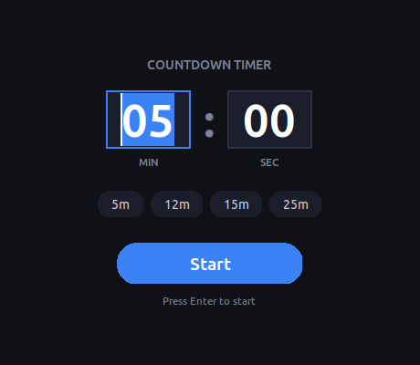

# Countdown Timer

A simple fullscreen countdown timer for Windows (and anywhere Python + Tkinter runs). Set the time, hit Start, and the screen turns into a big countdown. When it reaches zero the screen goes red with **TIME'S UP!**



## Download

Grab `CountdownTimer.exe` from the [latest release](../../releases/latest). It bundles Python, so there is nothing to install — just double-click it.

> Windows SmartScreen may warn about an unsigned app. Click **More info → Run anyway**.

## Usage

1. Enter minutes and seconds (or click a preset: 5m, 12m, 15m, 25m).
2. Click **Start** or press **Enter**. The timer goes fullscreen and starts counting down immediately.

| Key / control | Action |
| --- | --- |
| **Space** | Pause / resume (the digits turn yellow while paused) |
| **Esc** | Reset to the time you set (digits flash red for a second), paused until you press Space. Works after TIME'S UP too. Esc does not close the app |
| **Q** or **Exit** button (top right) | Back to the setup screen. The app stays open |

To close the app, use the window's close button on the setup screen.

## Run from source

Requires Python 3 with Tkinter (included in the official Windows installer).

```
python countdown_timer.py
```

## Build the exe yourself

```
pip install pyinstaller
pyinstaller --onefile --windowed --name CountdownTimer --icon icon.ico --add-data "icon.png;." countdown_timer.py
```

The result is `dist/CountdownTimer.exe`.

## Releases

Pushing to `main` builds the exe and attaches it to the workflow run as an artifact. Pushing a tag like `v1.0.1` builds it and publishes a GitHub release with the exe attached:

```
git tag v1.0.1
git push origin v1.0.1
```
